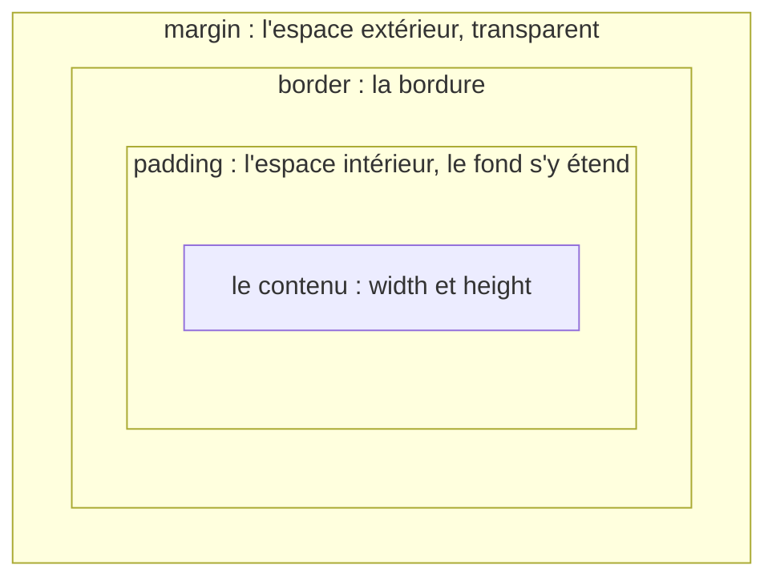

Pour le navigateur, chaque élément d'une page est une **boîte** rectangulaire, faite de quatre couches : le contenu, l'espace intérieur, la bordure et l'espace extérieur. Vous saurez nommer ces couches, choisir entre `padding` et `margin`, calculer la largeur réelle d'une boîte, qui n'est pas celle que vous avez écrite, la rendre prévisible avec `box-sizing: border-box`, et comprendre pourquoi un `<span>` ignore la largeur qu'on lui donne.

**Prérequis** : [CSS : règles, sélecteurs et cascade](https://byte-layers.com/fr/bits/css-rules-cascade), pour écrire une règle et viser une classe.

# Le modèle de boîte : contenu, padding, bordure, marge

Le contenu précédent réglait l'apparence du texte : sa police, sa couleur. Ce contenu règle la place que prend chaque élément, et l'espace entre eux.

## Chaque élément est une boîte en quatre couches

Un paragraphe, un titre, une carte : chacun occupe un rectangle, et ce rectangle se lit de l'intérieur vers l'extérieur. C'est le **modèle de boîte** (*box model*).



| Couche | Propriété | Ce qu'elle fait |
|---|---|---|
| le **contenu** | `width`, `height` | la zone du texte ou de l'image |
| le **padding** | `padding` | l'espace entre le contenu et la bordure ; le fond de l'élément s'y étend |
| la **bordure** | `border` | le trait autour du padding |
| la **marge** | `margin` | l'espace autour de la bordure, qui sépare l'élément de ses voisins ; le fond du parent y apparaît |

Chaque propriété se règle pour les quatre côtés d'un coup (`padding: 20px`) ou côté par côté (`padding-top`, `padding-right`, `padding-bottom`, `padding-left`). La bordure demande **trois informations** : une épaisseur, un style et une couleur, par exemple `border: 1px solid rgb(215, 222, 232)`. Sans le style `solid`, elle n'apparaît pas : le style vaut `none` par défaut.

## Padding dedans, marge dehors

Pour choisir entre les deux, une seule question : le fond de l'élément doit-il s'étendre dans cet espace ? Oui : c'est du `padding`, le texte s'éloigne du bord de la carte. Non : c'est une `margin`, les cartes s'éloignent les unes des autres.

Dans la page ci-dessous, les deux cartes sont collées l'une à l'autre, leur texte touche les bords, et la bordure prévue ne s'affiche pas. Le HTML est fourni en lecture seule : complète la règle `.carte` dans `style.css`.

```playground
runtime: web
title: Aère les cartes
files:
  index.html: |
    <!DOCTYPE html>
    <html lang="fr">
    <head>
      <meta charset="utf-8">
      <title>Nos services</title>
      <link rel="stylesheet" href="style.css">
    </head>
    <body>
      <main>
        <div class="carte">
          <h2>Emprunter</h2>
          <p>Jusqu'à dix documents pour trois semaines.</p>
        </div>
        <div class="carte">
          <h2>Travailler sur place</h2>
          <p>Quarante places assises et le wifi gratuit.</p>
        </div>
      </main>
    </body>
    </html>
  style.css: |
    body {
      background-color: rgb(238, 241, 245);
      font-family: system-ui, "Segoe UI", sans-serif;
    }

    .carte {
      background-color: rgb(255, 255, 255);
      border: 1px rgb(215, 222, 232);
    }
open: [style.css, index.html]
lock: [index.html]
verify:
  - label: la bordure des cartes s'affiche, un trait plein de 1 px
    selector: .carte
    style: { border-top-style: solid, border-top-width: 1px }
    hint: "Une bordure demande trois informations : l'épaisseur, le style (`solid`) et la couleur"
  - label: le texte s'éloigne du bord de la carte, 20 px de chaque côté
    selector: .carte
    style: { padding-top: 20px, padding-left: 20px }
    hint: "L'espace intérieur, dans lequel le fond blanc s'étend : `padding`"
  - label: les cartes s'éloignent l'une de l'autre, 20 px en dessous de chacune
    selector: .carte
    style: { margin-bottom: 20px }
    hint: "L'espace extérieur, où le gris de la page apparaît : `margin-bottom`"
solution: assets/espaces.solution
```

## La vraie largeur d'une boîte : width, padding et bordure

Par défaut, `width` règle la largeur du **contenu** seulement. Le padding et la bordure s'ajoutent autour. Une boîte écrite `width: 300px; padding: 20px; border: 5px solid` occupe donc 300 + 20 + 20 + 5 + 5 pixels : 350, et non 300.

```fill
text: "Une boîte a `width: 200px`, `padding: 10px` et `border: 2px solid`. Elle occupe _____ px de large, marges non comprises."
blanks:
  - answers: [224]
    hint: "Le padding et la bordure comptent deux fois : à gauche et à droite. 200 + 10 + 10 + 2 + 2."
```

C'est le piège classique : on donne à une carte la largeur de sa colonne, on lui ajoute du padding, et elle déborde. La propriété `box-sizing` change ce calcul :

| `box-sizing` | `width` désigne | `width: 300px` et `padding: 20px` occupent |
|---|---|---|
| `content-box` (par défaut) | le contenu seul | 340 px |
| `border-box` | la boîte entière, padding et bordure compris | 300 px, le contenu se réduit à 260 px |

La plupart des feuilles de style professionnelles s'ouvrent par une règle qui l'applique à tous les éléments, avec le **sélecteur universel** `*` :

```css
* {
  box-sizing: border-box;
}
```

> 💡 **Remarque.** C'est l'écart d'Internet Explorer 5 évoqué dans le contenu sur les trois langages : il calculait déjà la largeur à la manière de `border-box`, quand les autres navigateurs suivaient `content-box`. `box-sizing` a fini par laisser chacun choisir.

Dans la page ci-dessous, la carte doit tenir exactement dans sa colonne bleue de 300 px. Elle déborde à droite. Corrige `style.css` sans retirer le padding.

```playground
runtime: web
title: Le piège de la largeur
files:
  index.html: |
    <!DOCTYPE html>
    <html lang="fr">
    <head>
      <meta charset="utf-8">
      <title>Une colonne</title>
      <link rel="stylesheet" href="style.css">
    </head>
    <body>
      <div class="colonne">
        <div class="carte">
          <h2>Ateliers du samedi</h2>
          <p>Lecture pour les tout-petits et initiation à l'informatique.</p>
        </div>
      </div>
    </body>
    </html>
  style.css: |
    body {
      font-family: system-ui, "Segoe UI", sans-serif;
    }

    .colonne {
      width: 300px;
      background-color: rgb(224, 242, 254);
    }

    .carte {
      width: 100%;
      padding: 20px;
      border: 4px solid rgb(11, 107, 203);
      background-color: rgb(255, 255, 255);
    }
open: [style.css, index.html]
lock: [index.html]
verify:
  - label: la carte mesure 300 px, padding et bordure compris
    selector: .carte
    style: { box-sizing: border-box, width: 300px }
    hint: "Ajoute `* { box-sizing: border-box; }` en tête de la feuille, ou `box-sizing: border-box;` dans `.carte`"
  - label: elle garde son padding de 20 px
    selector: .carte
    style: { padding-left: 20px, padding-right: 20px }
solution: assets/largeur.solution
```

Avant de corriger, calculez de combien la carte déborde : 100 % de 300 px pour le contenu, plus 2 × 20 px de padding, plus 2 × 4 px de bordure, soit 348 px, et 48 px qui dépassent.

## Bloc ou en ligne : un `span` ignore `width`

Les boîtes ne se comportent pas toutes de la même façon. Un élément **bloc** (`<p>`, `<h2>`, `<div>`, `<section>`) prend toute la largeur disponible et commence sur une nouvelle ligne ; il accepte `width` et `height`. Un élément **en ligne** (*inline* : `<span>`, `<a>`, `<strong>`) se glisse dans le texte, à la suite des mots ; il **ignore** `width` et `height`, et ses marges du haut et du bas n'écartent pas les lignes.

La propriété `display` change ce comportement : `display: inline-block` garde l'élément dans la ligne, mais lui fait accepter une largeur.

Dans la page ci-dessous, l'étiquette « Gratuit » devrait mesurer 120 px de large, et la règle le demande bien. Rien n'y fait. Corrige la règle `.badge`.

```playground
runtime: web
title: Une étiquette qui accepte sa largeur
files:
  index.html: |
    <!DOCTYPE html>
    <html lang="fr">
    <head>
      <meta charset="utf-8">
      <title>Inscriptions</title>
      <link rel="stylesheet" href="style.css">
    </head>
    <body>
      <p>Nouveau : <span class="badge">Gratuit</span> l'inscription des moins de dix-huit ans.</p>
    </body>
    </html>
  style.css: |
    body {
      font-family: system-ui, "Segoe UI", sans-serif;
    }

    .badge {
      width: 120px;
      background-color: rgb(219, 39, 119);
      color: rgb(255, 255, 255);
      text-align: center;
    }
open: [style.css, index.html]
lock: [index.html]
verify:
  - label: l'étiquette devient une boîte qui accepte une largeur
    selector: .badge
    style: { display: "/^(inline-block|block)$/", width: 120px }
    hint: "Un `<span>` est un élément en ligne : `display: inline-block;` lui fait accepter `width`"
solution: assets/inline.solution
```

> 📖 [Le modèle de boîte (MDN)](https://developer.mozilla.org/fr/docs/Learn_web_development/Core/Styling_basics/Box_model) · [La propriété box-sizing (MDN)](https://developer.mozilla.org/fr/docs/Web/CSS/Reference/Properties/box-sizing) · [La propriété display (MDN)](https://developer.mozilla.org/fr/docs/Web/CSS/Reference/Properties/display)

## Trois questions pour vérifier ce que vous avez retenu

```quiz
title: "Le modèle de boîte"
tracksProgress: false
showNotice: false
place: stage
questions:
  - prompt: "Vous voulez que le texte d'une carte s'éloigne de son bord, et que le fond blanc de la carte s'étende dans cet espace. Quelle propriété ?"
    answers:
      - "`padding`, l'espace intérieur"
      - "`margin`, l'espace extérieur"
      - "`border`"
    correct: 1
    explanation: "Le fond d'un élément s'étend dans son padding, pas dans sa marge. La marge sépare l'élément de ses voisins, et laisse voir le fond du parent."
  - prompt: "Sans `box-sizing`, une boîte a `width: 300px`, `padding: 20px` et `border: 5px solid`. Quelle largeur occupe-t-elle ?"
    answers:
      - "300 px"
      - "350 px : 300 de contenu, 2 × 20 de padding, 2 × 5 de bordure"
      - "320 px"
    correct: 2
    explanation: "Par défaut (`content-box`), `width` ne règle que le contenu ; le padding et la bordure s'ajoutent des deux côtés. Avec `border-box`, la boîte ferait 300 px."
  - prompt: "Une règle donne `width: 100px` à un `<span>`, et sa largeur ne change pas. Pourquoi ?"
    answers:
      - "Il faut écrire la largeur en pourcentage"
      - "La règle est mal reliée"
      - "Un `<span>` est un élément en ligne, qui ignore `width` ; `display: inline-block` le lui fait accepter"
    correct: 3
    explanation: "Les éléments en ligne se glissent dans le texte et ignorent `width` et `height`. `inline-block` les garde dans la ligne tout en acceptant une largeur."
```

## Récap

- Chaque élément est une **boîte** : le contenu (`width`, `height`), le **padding**, la **bordure**, la **marge**.
- **Padding dedans** (le fond s'y étend), **marge dehors** (le fond du parent apparaît).
- Une bordure demande une épaisseur, un **style** et une couleur : sans `solid`, rien ne s'affiche.
- Par défaut, la **largeur réelle** vaut `width` + padding + bordure, des deux côtés ; `* { box-sizing: border-box; }` fait de `width` la largeur de la boîte entière.
- Un élément **en ligne** comme `<span>` ignore `width` ; `display: inline-block` la lui fait accepter.

Vous avez vu, un par un, les morceaux d'une page : sa requête, ses trois langages, son squelette, son sens, ses règles et ses boîtes. Le lab les assemble sur votre machine, avec VS Code et un navigateur : [Les bases HTML et CSS, sur votre machine](https://byte-layers.com/fr/labs/html-css-basics-lab).

```ack
J'ai compris
```
