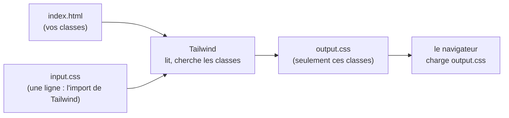

**Tailwind** est un framework CSS qui ne vous donne pas une feuille de style toute faite : il **fabrique** la vôtre à partir des classes que vous écrivez dans le HTML. Entre ce que vous écrivez et ce que reçoit le navigateur, il y a donc une **étape de traitement**. Vous saurez lire une classe utilitaire, ce que produit le traitement, pourquoi une classe peut ne rien faire, et à quoi servent les outils de build qu'on croise dans tout projet web.

**Prérequis** : le bit [Bootstrap : des classes CSS toutes faites](https://byte-layers.com/fr/bits/css-frameworks), et le bit [Compilé ou interprété](https://byte-layers.com/fr/bits/compiled-or-interpreted) pour l'idée de traduction avant l'exécution.

# Tailwind, et pourquoi le CSS se compile

Avec Bootstrap, le navigateur télécharge un fichier de `230 Ko`, que la page utilise ou non chacune de ses classes. Tailwind prend le chemin inverse : il lit vos fichiers et n'écrit que le CSS dont ils ont besoin.

## Des classes utilitaires : une classe, une propriété

Une **classe utilitaire** applique une seule chose, presque toujours une seule propriété CSS. On compose l'apparence d'un élément en les accumulant dans son attribut `class`, au lieu d'écrire une règle dans une feuille de style.

```html
<a class="px-4 py-2 rounded-lg bg-blue-700 text-white" href="#contact">Me contacter</a>
```

| Classe | Ce qu'elle écrit en CSS |
|---|---|
| `px-4` | `padding-inline: 1rem` (16 px à gauche et à droite) |
| `py-2` | `padding-block: 0.5rem` (8 px en haut et en bas) |
| `rounded-lg` | `border-radius: 0.5rem` |
| `bg-blue-700` | une couleur de fond, la nuance 700 de la palette bleue |
| `text-white` | `color: #fff` |
| `md:flex` | `display: flex`, dans une media query à partir de 768 px |

Bootstrap donne des **composants** (`btn`, `card`) ; Tailwind donne des **briques**, et le style naît de leur assemblage dans le HTML. Le HTML devient plus chargé, la feuille de style disparaît presque, et chaque choix se voit là où il s'applique.

## Le CSS produit : seulement les classes que vous utilisez

Tailwind ne se charge pas depuis un CDN dans un vrai projet : il **tourne sur votre machine**, comme un programme, et il écrit un fichier CSS. Le schéma suivant montre le trajet, de ce que vous écrivez au fichier que charge la page.



Le fichier d'entrée, `input.css`, tient en une ligne : `@import "tailwindcss";`. La commande lit ce fichier, parcourt les fichiers du dossier à la recherche de noms de classes, et écrit `output.css`. C'est **`output.css`**, et non `input.css`, que la page charge avec son `<link>`. Complète la commande qui lance le traitement.

```fill
text: "npx @tailwindcss/cli -i _____ -o _____"
blanks:
  - answers: [input.css, ./input.css]
    hint: "`-i` pour *input* : le fichier d'entrée, celui qui contient `@import \"tailwindcss\";`."
  - answers: [output.css, ./output.css]
    hint: "`-o` pour *output* : le fichier produit, que la page charge."
```

C'est la même idée que la compilation vue dans le bit [Compilé ou interprété](https://byte-layers.com/fr/bits/compiled-or-interpreted) : un programme traduit vos fichiers **avant** que le navigateur ne les lise, et ce que reçoit le navigateur n'est pas ce que vous avez écrit. Le résultat reste du CSS ordinaire, lisible, que vous pouvez ouvrir.

## Le piège : une classe absente du CSS produit

Le fichier produit est une photographie : il contient les classes trouvées **au moment du traitement**, pas une de plus. Une classe ajoutée au HTML **après** le traitement, ou mal orthographiée, n'a aucune règle dans `output.css` : elle ne fait rien, et rien ne le signale. C'est pourquoi on lance le traitement en mode surveillance pendant qu'on travaille (option `--watch`) : il réécrit `output.css` à chaque enregistrement.

**À toi** : `output.css` est le fichier produit par Tailwind la dernière fois que le traitement a tourné ; il est en lecture seule, comme si personne ne l'avait relancé depuis. Le bouton a été modifié ensuite, avec `bg-pink-600` et `px-6`, et il n'a plus ni fond ni marge intérieure. Lis `output.css`, puis donne au bouton un fond et un padding horizontal avec des classes **qui y figurent** : le fond bleu et `16px` à gauche et à droite.

```playground
runtime: web
title: Une classe qui ne fait rien
files:
  index.html: |
    <!DOCTYPE html>
    <html lang="fr">
    <head>
      <meta charset="utf-8">
      <title>Camille Martin</title>
      <link rel="stylesheet" href="output.css">
    </head>
    <body>
      <article class="p-6 rounded-lg bg-white text-slate-800">
        <h2 class="text-2xl font-bold">Travaillons ensemble</h2>
        <a class="bouton px-6 py-2 rounded-lg bg-pink-600 text-white" href="#contact">Me contacter</a>
      </article>
    </body>
    </html>
  output.css: |
    /*! tailwindcss v4.3.5 | MIT License | https://tailwindcss.com */
    @layer properties;
    @layer theme {
      :root, :host {
        --color-blue-700: oklch(48.8% 0.243 264.376);
        --color-slate-800: oklch(27.9% 0.041 260.031);
        --color-white: #fff;
        --spacing: 0.25rem;
        --text-2xl: 1.5rem;
        --text-2xl--line-height: calc(2 / 1.5);
        --font-weight-bold: 700;
        --radius-lg: 0.5rem;
      }
    }
    @layer utilities {
      .rounded-lg {
        border-radius: var(--radius-lg);
      }
      .bg-blue-700 {
        background-color: var(--color-blue-700);
      }
      .bg-white {
        background-color: var(--color-white);
      }
      .p-6 {
        padding: calc(var(--spacing) * 6);
      }
      .px-4 {
        padding-inline: calc(var(--spacing) * 4);
      }
      .py-2 {
        padding-block: calc(var(--spacing) * 2);
      }
      .text-2xl {
        font-size: var(--text-2xl);
        line-height: var(--tw-leading, var(--text-2xl--line-height));
      }
      .font-bold {
        --tw-font-weight: var(--font-weight-bold);
        font-weight: var(--font-weight-bold);
      }
      .text-slate-800 {
        color: var(--color-slate-800);
      }
      .text-white {
        color: var(--color-white);
      }
    }
    @property --tw-font-weight {
      syntax: "*";
      inherits: false;
    }
    @layer properties {
      @supports ((-webkit-hyphens: none) and (not (margin-trim: block))) or ((-moz-orient: inline) and (not (color:rgb(from red r g b)))) {
        *, ::before, ::after, ::backdrop {
          --tw-font-weight: initial;
        }
      }
    }
open: [index.html, output.css]
lock: [output.css]
verify:
  - label: le bouton a le fond bleu de `output.css`
    selector: .bouton
    style: { background-color: "/^oklch\\(0\\.488 /" }
    hint: "`bg-pink-600` n'est pas dans `output.css`. Quelle classe `bg-…` bleue y figure ?"
  - label: le bouton a `16px` de padding à gauche et à droite
    selector: .bouton
    style: { padding-left: 16px, padding-right: 16px }
    hint: "`px-6` n'est pas dans `output.css`, `px-4` y est : `4 × 0.25rem`, soit `16px`."
solution: assets/classe.solution
```

Dans un vrai projet, la bonne correction aurait été de **relancer le traitement** : `bg-pink-600` et `px-6` existent dans Tailwind, ils manquaient seulement à `output.css`. Le lab de ce cours vous le fait constater sur votre machine.

## Une famille d'outils : PostCSS, Webpack, Parcel, Vite

Tailwind n'est qu'un exemple d'une idée générale : dans un projet web, ce que vous écrivez passe par des **outils de build** avant d'arriver au navigateur. On ne les détaille pas ici ; il suffit de savoir qu'ils existent et ce qu'ils font, pour les reconnaître dans un projet.

| Outil | Ce qu'il fait |
|---|---|
| **PostCSS** | transforme du CSS par des extensions : ajouter les préfixes pour les anciens navigateurs, compresser ; Tailwind existe aussi sous forme d'extension PostCSS |
| **Webpack** | rassemble les fichiers d'un projet (JavaScript, CSS, images), qui dépendent les uns des autres, en quelques fichiers prêts pour le navigateur : le *bundle* |
| **Parcel** | fait le même travail que Webpack, avec presque aucune configuration |
| **Vite** | sert le projet pendant le développement et recharge la page à chaque enregistrement, puis produit les fichiers finaux |

Le schéma de la page d'accueil de [webpack](https://webpack.js.org) résume l'idée : à gauche, des modules qui s'importent les uns les autres ; à droite, les fichiers statiques (*static assets*) que reçoit le navigateur.

> 📖 [Tailwind CSS, installation avec la CLI (en anglais)](https://tailwindcss.com/docs/installation/tailwind-cli) · [Les classes utilitaires de Tailwind (en anglais)](https://tailwindcss.com/docs/styling-with-utility-classes) · [PostCSS (en anglais)](https://postcss.org/) · [webpack, concepts (en anglais)](https://webpack.js.org/concepts/) · [Vite, pourquoi Vite (en anglais)](https://vite.dev/guide/why)

## Trois questions pour vérifier

```quiz
title: "Tailwind et les outils de build"
tracksProgress: false
showNotice: false
place: stage
questions:
  - prompt: "Quel fichier la page HTML charge-t-elle avec son `<link>` ?"
    answers:
      - "`input.css`, qui contient `@import \"tailwindcss\";`"
      - "`output.css`, le fichier produit par le traitement"
      - "Les deux"
    correct: 2
    explanation: "input.css est l'entrée de Tailwind ; le navigateur ne sait pas quoi faire de son @import. La page charge le CSS produit."
  - prompt: "Vous ajoutez `underline` sur un lien, enregistrez, rechargez : le lien n'est pas souligné. Pourquoi, le plus probablement ?"
    answers:
      - "La classe `underline` n'existe pas dans Tailwind"
      - "Le traitement n'a pas tourné depuis : `output.css` ne contient pas la classe"
      - "Le navigateur ne connaît pas Tailwind"
    correct: 2
    explanation: "output.css ne contient que les classes vues au dernier traitement. Relancez-le, ou laissez-le tourner avec --watch."
  - prompt: "À quoi sert un outil comme Webpack ou Vite ?"
    answers:
      - "À héberger le site sur Internet"
      - "À transformer et rassembler les fichiers d'un projet en fichiers prêts pour le navigateur"
      - "À écrire le HTML à votre place"
    correct: 2
    explanation: "Ce sont des outils de build : entre ce que vous écrivez et ce que reçoit le navigateur, ils traitent et regroupent les fichiers."
```

## Récap

- Tailwind fournit des **classes utilitaires**, une propriété chacune, qu'on assemble dans le HTML.
- Il **fabrique** `output.css` à partir des classes trouvées dans vos fichiers : la page charge **le CSS produit**, pas `input.css`.
- Une classe ajoutée **après** le traitement n'est pas dans le CSS produit et ne fait rien : relancez le traitement, ou gardez `--watch`.
- **PostCSS**, **Webpack**, **Parcel**, **Vite** sont des **outils de build** : ils traitent ce que vous écrivez avant que le navigateur ne le lise.

Les neuf notions de ce cours se pratiquent maintenant sur votre machine, dans un même dossier, avec le vrai Tailwind en dernière étape : c'est le lab [HTML et CSS avancé, sur votre machine](https://byte-layers.com/fr/labs/html-css-advanced-lab).

```ack
J'ai compris
```
