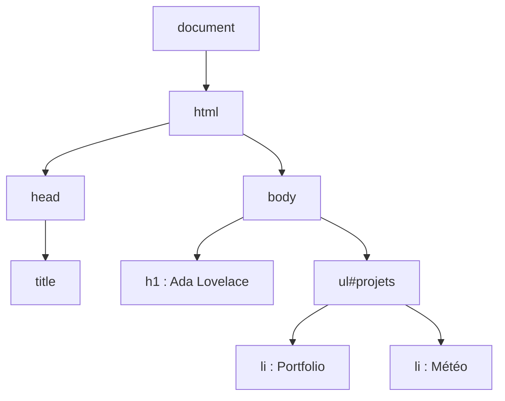

La page HTML que vous avez écrite, JavaScript la voit comme un arbre d'objets, le **DOM**, qu'il peut lire et changer. Vous saurez trouver des éléments avec `querySelector` et `querySelectorAll`, changer leur texte avec `textContent` et leurs classes avec `classList`, créer un élément et l'insérer dans la page, et éviter deux pièges : `querySelector` ne rend que le premier élément trouvé, et `querySelectorAll` ne rend pas un vrai tableau.

**Prérequis** : [Fonctions et objets](https://byte-layers.com/fr/bits/js-functions-objects), pour les objets et la notation à point, et [Où vit le JavaScript dans une page](https://byte-layers.com/fr/bits/js-in-page), pour `defer`.

# Le DOM : la page vue par JavaScript

Jusqu'ici, votre code parle à la console. À partir de maintenant, il parle à la page : il lit ce qu'elle contient, le modifie, ajoute des éléments qui n'existaient pas.

## Le DOM : la page sous forme d'objets

En lisant le HTML, le navigateur construit en mémoire un **arbre d'objets** : un objet par élément, rangé dans son parent, comme les balises sont imbriquées. Cet arbre s'appelle le **DOM** (*Document Object Model*, le modèle objet du document). C'est lui que le navigateur dessine, et c'est lui que JavaScript modifie, à partir de l'objet **`document`**, la racine de l'arbre.

Le schéma montre l'arbre construit pour une petite page : le `body` contient un titre et une liste, la liste contient deux éléments.



Le fichier HTML, lui, ne change jamais. Quand JavaScript ajoute un élément, il l'ajoute au DOM : la page affichée le montre, mais le code source (clic droit, **Afficher le code source**) reste tel que vous l'avez écrit. L'onglet **Éléments** (*Elements*, ou *Inspecteur* dans Firefox) des outils de développement, lui, montre le DOM, modifications comprises.

## Trouver des éléments : `querySelector` et `querySelectorAll`

Pour agir sur un élément, on commence par le trouver, avec un **sélecteur CSS**, exactement ceux de votre feuille de style : `"h1"`, `".projet"`, `"#compteur"`, `"nav a"`.

| Méthode | Rend | S'il n'y a rien |
|---|---|---|
| `document.querySelector(sel)` | le **premier** élément qui correspond, et lui seul | `null` |
| `document.querySelectorAll(sel)` | **tous** les éléments, dans une liste (une `NodeList`) | une liste vide, de `length` 0 |

Une `NodeList` ressemble à un tableau : elle a un `length`, des index, et `for…of` la parcourt. Mais ce n'est **pas un tableau** : les méthodes de tableau comme `map` n'y existent pas, et `document.querySelectorAll(".projet").map(…)` lève `TypeError: … .map is not a function`. Pour en faire un vrai tableau : `Array.from(liste)`.

La page contient trois projets, et le paragraphe `#compteur` doit dire combien. Le code affiche « undefined projets » : corrigez la recherche, sans écrire le nombre à la main.

```playground
runtime: web
title: Compte les projets de la page
files:
  index.html: |
    <!DOCTYPE html>
    <html lang="fr">
    <head>
      <meta charset="utf-8">
      <title>Mes projets</title>
      <script src="script.js" defer></script>
    </head>
    <body>
      <h1>Mes projets</h1>
      <p id="compteur">— projets</p>
      <article class="projet"><h2>Portfolio</h2></article>
      <article class="projet"><h2>Météo</h2></article>
      <article class="projet"><h2>Quiz</h2></article>
    </body>
    </html>
  script.js: |
    const projets = document.querySelector(".projet");
    const compteur = document.querySelector("#compteur");
    compteur.textContent = projets.length + " projets";
open: [script.js, index.html]
lock: [index.html]
show: [editor, preview, console]
verify:
  - label: "`#compteur` affiche « 3 projets »"
    selector: "#compteur"
    text: 3 projets
    hint: "`querySelector` rend un seul élément, qui n'a pas de `length`. Pour tous les projets : `querySelectorAll`."
  - label: le nombre vient de `length`, pas d'un 3 écrit à la main
    file: script.js
    excludes: /["'`]3 projets/
solution: assets/compter.solution
```

`querySelector(".projet")` rendait le premier projet seulement, un élément, pas une liste : il n'a pas de `length`, d'où `undefined`. Aucune erreur rouge, juste un texte faux.

## Changer un élément : `textContent` et `classList`

Un élément trouvé est un objet : on change ce qu'il affiche en modifiant ses propriétés.

| Propriété | Exemple | Effet |
|---|---|---|
| `textContent` | `titre.textContent = "Bonjour"` | remplace le texte de l'élément |
| `classList.add` | `carte.classList.add("en-avant")` | pose une classe |
| `classList.remove` | `carte.classList.remove("en-avant")` | retire une classe |
| `classList.toggle` | `carte.classList.toggle("en-avant")` | pose la classe si elle manque, la retire sinon |
| `classList.contains` | `carte.classList.contains("en-avant")` | `true` ou `false` |
| `style` | `carte.style.background = "yellow"` | écrit un style directement sur l'élément |

On préfère **`classList`** à `style` : la couleur reste dans le CSS, où elle se change en un seul endroit, et retirer la classe suffit à revenir en arrière. Un style écrit par `style` l'emporte sur les classes, et il faut penser à le vider.

Le CSS de la page contient une classe `en-avant`, qui donne un fond jaune clair. Le code veut la poser sur les trois projets, mais s'arrête sur une erreur : lisez-la, puis corrigez.

```playground
runtime: web
title: Mets en avant chaque projet
files:
  index.html: |
    <!DOCTYPE html>
    <html lang="fr">
    <head>
      <meta charset="utf-8">
      <title>Mes projets</title>
      <link rel="stylesheet" href="style.css">
      <script src="script.js" defer></script>
    </head>
    <body>
      <h1>Mes projets</h1>
      <article class="projet"><h2>Portfolio</h2></article>
      <article class="projet"><h2>Météo</h2></article>
      <article class="projet"><h2>Quiz</h2></article>
    </body>
    </html>
  style.css: |
    .projet { padding: 8px; border: 1px solid rgb(203, 213, 225); margin: 8px 0; }
    .en-avant { background-color: rgb(254, 243, 199); }
  script.js: |
    const projets = document.querySelectorAll(".projet");
    projets.classList.add("en-avant");
open: [script.js, index.html, style.css]
lock: [index.html, style.css]
show: [editor, preview, console]
verify:
  - label: les trois projets portent la classe `en-avant`
    selector: ".projet.en-avant"
    count: 3
    hint: "Une liste n'a pas de `classList` : chaque élément en a une. Parcours la liste avec `for (const projet of projets)`."
  - label: leur fond est jaune clair, grâce à la classe
    selector: ".projet"
    style: { background-color: "rgb(254, 243, 199)" }
  - label: aucun style écrit en JavaScript
    file: script.js
    excludes: /\.style\b/
    hint: "Pose la classe avec `classList.add`, la couleur reste dans le CSS."
  - label: aucune erreur JavaScript
    errors: none
solution: assets/classes.solution
```

L'erreur disait `Cannot read properties of undefined (reading 'add')` : la liste n'a pas de propriété `classList`, donc `projets.classList` vaut `undefined`, et l'on ne peut rien lire dedans. Chaque élément de la liste, lui, a sa `classList` : la boucle les prend un par un.

## Créer et insérer : `createElement` et `append`

Pour ajouter un élément qui n'existe pas dans le HTML, on le fabrique, on le remplit, puis on l'insère dans un parent :

```javascript
const li = document.createElement("li"); // fabrique un <li>, encore hors de la page
li.textContent = "HTML";                  // le remplit
liste.append(li);                         // l'insère à la fin de liste : il apparaît
```

Un élément fabriqué n'est pas dans la page tant qu'il n'est pas inséré : si le code tourne sans erreur et que rien ne s'affiche, c'est presque toujours un `append` oublié. Pour une liste, les trois gestes vont **dans** la boucle : un `createElement` placé avant la boucle fabrique un seul élément, que chaque `append` déplace, et la page n'affiche que le dernier.

Remplissez la liste `#competences` avec une ligne par compétence du tableau.

```playground
runtime: web
title: Construis la liste des compétences
files:
  index.html: |
    <!DOCTYPE html>
    <html lang="fr">
    <head>
      <meta charset="utf-8">
      <title>Compétences</title>
      <script src="script.js" defer></script>
    </head>
    <body>
      <h1>Mes compétences</h1>
      <ul id="competences"></ul>
    </body>
    </html>
  script.js: |
    const competences = ["HTML", "CSS", "JavaScript", "Git"];
    const liste = document.querySelector("#competences");

    // À toi : un <li> par compétence, inséré dans liste
open: [script.js, index.html]
lock: [index.html]
show: [editor, preview, console]
check: ask
verify:
  - label: la liste contient quatre lignes
    selector: "#competences li"
    count: 4
    hint: "Dans une boucle `for (const competence of competences)` : `createElement(\"li\")`, `textContent`, puis `liste.append(li)`."
  - label: la première ligne affiche « HTML »
    selector: "#competences li:first-child"
    text: HTML
  - label: la dernière ligne affiche « Git »
    selector: "#competences li:last-child"
    text: Git
    hint: "Si une seule ligne apparaît, avec « Git », ton `createElement` est hors de la boucle : un seul élément a été déplacé quatre fois."
solution: assets/creer.solution
```

> 📖 [Introduction au DOM (MDN)](https://developer.mozilla.org/fr/docs/Web/API/Document_Object_Model/Introduction) · [querySelectorAll (MDN)](https://developer.mozilla.org/fr/docs/Web/API/Document/querySelectorAll) · [classList (MDN)](https://developer.mozilla.org/fr/docs/Web/API/Element/classList) · [createElement (MDN)](https://developer.mozilla.org/fr/docs/Web/API/Document/createElement)

## Trois questions pour vérifier ce que vous avez retenu

```quiz
title: "Le DOM"
tracksProgress: false
showNotice: false
place: stage
questions:
  - prompt: "La page contient cinq éléments `.livre`. Que rend `document.querySelector(\".livre\")` ?"
    answers:
      - "Une liste des cinq livres"
      - "Le premier livre seulement"
      - "Le dernier livre"
    correct: 2
    explanation: "querySelector s'arrête au premier élément qui correspond. Pour les cinq, il faut querySelectorAll."
  - prompt: "Que rend `document.querySelectorAll(\".perdu\")` quand aucun élément n'a cette classe ?"
    answers:
      - "null"
      - "Une liste vide, de length 0"
      - "Une erreur rouge"
    correct: 2
    explanation: "querySelectorAll rend toujours une liste, vide s'il n'y a rien : une boucle dessus ne fait simplement aucun tour. C'est querySelector qui rend null."
  - prompt: "Pourquoi `document.querySelectorAll(\".projet\").map(…)` lève-t-il une erreur ?"
    answers:
      - "Parce que la page n'a pas de projet"
      - "Parce que la NodeList n'est pas un tableau : elle n'a pas de méthode map"
      - "Parce que map n'existe pas en JavaScript"
    correct: 2
    explanation: "Une NodeList a un length, des index, et for…of la parcourt, mais pas les méthodes des tableaux comme map. Array.from(liste) en fait un vrai tableau."
```

## Récap

- Le **DOM** est l'arbre d'objets que le navigateur construit à partir du HTML ; JavaScript le modifie à partir de `document`, et le fichier HTML, lui, ne change pas.
- **`querySelector`** rend le **premier** élément trouvé (ou `null`) ; **`querySelectorAll`** rend une `NodeList` de tous les éléments, vide s'il n'y a rien, qui **n'est pas un tableau**.
- **`textContent`** change le texte ; **`classList`** pose, retire, bascule des classes, et la couleur reste dans le CSS.
- **`createElement`** fabrique un élément, **`append`** l'insère ; pour une liste, les deux gestes vont dans la boucle.

Votre code construit la page une fois, au chargement, puis ne fait plus rien. Pour qu'il attende que le visiteur clique ou tape, il faut écouter des événements : c'est l'objet du bit [Les événements : réagir aux actions du visiteur](https://byte-layers.com/fr/bits/dom-events).

```ack
J'ai compris
```
