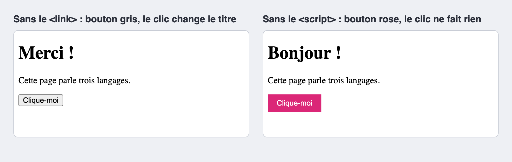

Le bit [Une page web : HTML, CSS et JavaScript](https://byte-layers.com/fr/bits/web-page-languages) partageait une page entre trois langages. Pour voir ce que fait chacun, on y touche : d'abord sur un vrai site, en retouchant une page avec les outils de développement, une retouche par langage ; puis sur une page que vous créez, en retirant le CSS, puis le JavaScript.

## 02.1 - Retoucher une page de MDN dans l'inspecteur


Ouvrez la page de MDN sur le HTML : `https://developer.mozilla.org/fr/docs/Web/HTML`. Son titre, en haut, est « HTML : HyperText Markup Language ».

**Trouver le titre dans le HTML.** Faites un clic droit sur le titre, puis **Inspecter**. Les outils de développement s'ouvrent sur l'onglet **Éléments** (*Elements* ; **Inspecteur** dans Firefox), qui montre le HTML de la page sous forme d'arbre. La ligne du titre est surlignée : c'est une balise `<h1>`. L'icône en forme de flèche, en haut à gauche des outils, fait la même chose : cliquez-la, puis cliquez sur un élément de la page.

**Changer son texte (HTML).** Dans l'arbre, double-cliquez sur le texte du titre, entre `<h1>` et `</h1>` : il devient modifiable. Tapez un autre titre, puis Entrée. La page change aussitôt.

**Changer sa couleur avec l'attribut `style` (CSS).** Faites un clic droit sur la balise `<h1>`, dans l'arbre, puis **Ajouter un attribut** (*Add attribute* ; dans Firefox, sous-menu **Attributs**). Tapez `style="color: deeppink"`, puis Entrée. Le titre devient rose : l'attribut `style` porte du CSS, écrit directement dans la balise.

**Changer sa taille dans le volet Styles (CSS).** Sous l'arbre, ou à côté, le volet **Styles** (**Règles** dans Firefox) liste le CSS qui s'applique à l'élément sélectionné. Son premier bloc, `element.style` (`élément` dans Firefox), est votre attribut `style` : `color: deeppink` y est déjà. Cliquez juste avant son accolade fermante, tapez `font-size`, Tab, `80px`, puis Entrée. Le titre grossit. Plus bas, la règle de MDN pour ce titre a sa propre `font-size`, maintenant **barrée** : elle ne s'applique plus, celle de l'attribut passe avant.

**Changer le texte avec JavaScript.** Ouvrez l'onglet **Console** : il exécute du JavaScript dans la page. Tapez la ligne suivante, puis Entrée :

```javascript
document.querySelector('h1').textContent = 'Modifié par JavaScript'
```

Le titre change encore. Si Chrome refuse de **coller** du code dans la console, c'est une protection : tapez la ligne à la main, ou tapez `allow pasting` comme il l'indique.

**Recharger.** Rechargez la page : le titre retrouve son texte, sa couleur et sa taille. Vos retouches n'ont vécu que dans votre navigateur, sur sa copie de la page ; le serveur de MDN n'a rien reçu. L'inspecteur sert à **essayer**, pas à enregistrer : on y teste une idée, puis on l'écrit dans ses propres fichiers.

## 02.2 - Créer une page en trois fichiers

Passons à une page à vous, en trois fichiers, pour voir les balises qui les relient, et ce que la page perd quand on en retire un. Cette section est un support : elle crée la page, que vous n'avez pas à écrire vous-même.


Les fichiers vont dans le dossier du lab, `~/byte-layers/web/basics`, créé à l'étape 01. Il doit exister **avant** d'être ouvert dans VS Code : s'il manque, créez-le d'abord, dans un terminal (`mkdir -p ~/byte-layers/web/basics`) ou dans l'explorateur de fichiers, puis ouvrez-le dans VS Code (**File (Fichier)**, **Open Folder… (Ouvrir le dossier…)**).

Dans VS Code, créez trois fichiers dans `BASICS`, et collez dans chacun le contenu ci-dessous. Le premier, `trois-langages.html`, contient la page :

```html
<!DOCTYPE html>
<html lang="fr">
<head>
  <meta charset="utf-8">
  <title>Trois langages</title>
  <link rel="stylesheet" href="trois-langages.css">
</head>
<body>
  <h1 id="titre">Bonjour !</h1>
  <p>Cette page parle trois langages.</p>
  <button type="button" id="bouton">Clique-moi</button>
  <script src="trois-langages.js"></script>
</body>
</html>
```

Le deuxième, `trois-langages.css`, donne au bouton sa couleur :

```css
#bouton {
  background-color: rgb(219, 39, 119);
  color: white;
  border: none;
  padding: 8px 16px;
}
```

Le troisième, `trois-langages.js`, change le titre au clic :

```javascript
document.querySelector('#bouton').addEventListener('click', function () {
  document.querySelector('#titre').textContent = 'Merci !';
});
```

Enregistrez les trois. Ouvrez ensuite la page dans le navigateur : dans l'explorateur de VS Code, clic droit sur `trois-langages.html`, **Reveal in Finder (Afficher dans le Finder)** sous macOS, **Reveal in File Explorer (Afficher dans l'Explorateur de fichiers)** sous Windows, puis double-clic sur le fichier. Le bouton est rose, et un clic change le titre en « Merci ! ».

```verify
D=~/byte-layers/web/basics
for f in trois-langages.html trois-langages.css trois-langages.js; do
  if [ ! -f "$D/$f" ]; then
    echo "Il manque $f dans $D. Créez-le dans VS Code, collez son contenu, puis enregistrez."
    exit 1
  fi
done
if ! grep -q 'background-color' "$D/trois-langages.css"; then
  echo "trois-langages.css ne contient pas la règle du bouton : collez-la, puis enregistrez."
  exit 1
fi
if ! grep -q 'addEventListener' "$D/trois-langages.js"; then
  echo "trois-langages.js ne contient pas le script : collez-le, puis enregistrez."
  exit 1
fi
echo "Les trois fichiers de la page sont en place."
```

## 02.3 - Une page ouverte depuis le disque

Regardez la barre d'adresse : elle commence par `file://`, suivi du chemin du fichier sur votre disque. Ouvrez l'onglet Réseau et rechargez : les trois fichiers y sont, mais aucun ne porte de code comme 200 ou 404. Aucun serveur n'a répondu : le navigateur a lu les fichiers directement sur le disque, comme le décrit le bit sur le web.

> 💡 **Remarque.** Si vous avez installé l'extension **Live Preview** de VS Code (éditeur Microsoft), clic droit sur `trois-langages.html`, **Show Preview** : la page s'ouvre par un petit serveur, à une adresse comme `http://127.0.0.1:3000/trois-langages.html`, et elle se recharge seule à chaque enregistrement. Dans un navigateur, à cette adresse, l'onglet Réseau montre alors de vrais codes 200. Elle n'est pas obligatoire pour ce lab.

## 02.4 - Retirer le link, puis le script

Dans `trois-langages.html`, transformez la ligne du `<link>` en commentaire, pour que le navigateur l'ignore : placez le curseur sur la ligne et tapez Cmd+/ sous macOS, Ctrl+/ ailleurs. VS Code l'entoure de `<!--` et `-->`. Enregistrez, rechargez : le bouton redevient gris, le bouton par défaut du navigateur. Cliquez dessus : le titre change quand même, le JavaScript ne dépend pas du CSS.

Refaites le même raccourci sur la ligne du `<link>` pour la rétablir, puis faites de même avec la ligne du `<script>`. Enregistrez, rechargez : le bouton est rose, mais le clic ne fait plus rien. Rétablissez enfin la ligne du `<script>`, enregistrez, et vérifiez que tout remarche.



Aucune erreur ne s'est affichée dans la page, ni sans le CSS ni sans le JavaScript : une page qui perd un fichier ne vous prévient pas.

```verify
F=~/byte-layers/web/basics/trois-langages.html
if [ ! -f "$F" ]; then
  echo "Le fichier $F n'existe pas : refaites la section 02.2."
  exit 1
fi
T=$(grep -v '<!--' "$F")
if ! echo "$T" | grep -q '<link rel="stylesheet" href="trois-langages.css">'; then
  echo "La ligne du <link> est absente ou encore en commentaire : rétablissez-la, puis enregistrez."
  exit 1
fi
if ! echo "$T" | grep -q '<script src="trois-langages.js"></script>'; then
  echo "La ligne du <script> est absente ou encore en commentaire : rétablissez-la, puis enregistrez."
  exit 1
fi
echo "Le link et le script sont rétablis : la page a retrouvé son style et son comportement."
```

> 📖 [Modifier le DOM dans Chrome (en anglais)](https://developer.chrome.com/docs/devtools/dom) · [Modifier le CSS dans Chrome (en anglais)](https://developer.chrome.com/docs/devtools/css) · [L'inspecteur de Firefox (en anglais)](https://firefox-source-docs.mozilla.org/devtools-user/page_inspector/) · [Live Preview (en anglais)](https://marketplace.visualstudio.com/items?itemName=ms-vscode.live-server)
