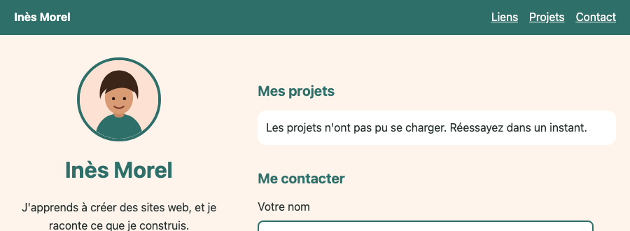

Ce challenge prouve que vous savez faire réagir une page avec JavaScript, seul, sur votre propre projet : votre page de liens. La version 1 l'a écrite, la version 2 l'a rendue adaptative et accessible, avec des projets et un formulaire de contact. Cette version 3 lui ajoute du **comportement** : les projets ne sont plus écrits dans le HTML, ils se chargent depuis un fichier de données, et le formulaire vérifie ce qu'on y tape avant de l'accepter. Il n'y a ni fichier à compléter ni corrigé : vos projets, vos textes et vos messages sont les vôtres.

L'apparence de la page ne change presque pas : ce qui change, c'est ce qu'elle **fait**. Voici le formulaire d'une page réussie. Un nom fait d'espaces est refusé, puis une adresse sans `@`, sans que les champs se vident ; une saisie correcte est confirmée, d'une autre couleur, et le message rejoint la liste des messages envoyés.


Et quand les projets ne peuvent pas se charger, la page le dit, au lieu de laisser une section vide :



## Ce qu'on attend, et ce qu'on n'attend pas

On attend une page qui **réagit sans se recharger** : des projets construits par le script à partir de `projets.json`, un formulaire qui refuse poliment et confirme clairement, des messages écrits dans la page, et une console sans erreur rouge.

On n'attend **pas** de vrai envoi : il n'y a pas de serveur, les messages restent dans la page et disparaissent au rechargement, c'est normal. Ni bibliothèque, ni framework, ni sauvegarde des messages, ni animation : du JavaScript écrit à la main, dans `script.js`.

Chaque tâche donne des critères, et un bouton vérifie vos fichiers pour chacun. Si vous êtes bloqué, les **indices** se dévoilent un par un et renvoient au contenu qui enseigne le point. Les utiliser ne coûte rien : seule la vérification compte.

## Avant de commencer

- **Ce qu'il faut savoir** : ce qu'enseignent les bits du cours, de [La console du navigateur](https://byte-layers.com/fr/bits/js-console) à [Données JSON et fetch](https://byte-layers.com/fr/bits/json-fetch), et le lab [Les bases de JavaScript, sur votre machine](https://byte-layers.com/fr/labs/js-basics-lab).
- **Ce qu'il faut avoir** : VS Code, un navigateur, Node.js (la vérification s'en sert pour lire vos fichiers), et un serveur local pour ouvrir la page : l'extension Live Preview de VS Code ou `python3 -m http.server`, comme à l'étape 08 du lab. Ouverte en `file://`, la page ne pourra pas charger ses projets.
- **Vos fichiers** : tout vit dans `~/byte-layers/web/portfolio`, le dossier des versions 1 et 2, avec son `index.html` et son `style.css`. Vous y ajoutez `script.js` et `projets.json`.
- **Si vous n'avez pas fait la version 2** : il vous faut au moins une page `index.html` avec une section de projets et un formulaire de contact, dont les champs ont chacun un `<label>` relié par `for` et `id` : un champ pour le nom, un pour l'adresse e-mail, un pour le message. Le challenge [Mon portfolio, version 2](https://byte-layers.com/fr/challenges/portfolio-v2-challenge) les construit.

Les vérifications lisent vos fichiers sur le disque, avec Node.js et quelques recherches dans le texte. Elles contrôlent ce qui se contrôle dans un fichier : un JSON valide, un `fetch`, un écouteur `submit`, un attribut `aria-live`. Elles **n'exécutent pas votre page** : que les projets s'affichent vraiment, que chaque message apparaisse au bon moment, c'est à vous de le tester dans le navigateur, cas par cas, console ouverte. Une console sans erreur rouge fait partie du travail.

# Tâche 1 : un script branché au bon endroit

## Le fichier script.js

Créez `script.js` dans le dossier du portfolio, et chargez-le depuis `index.html`. Pour commencer, une seule ligne suffit : un `console.log` qui prouve, dans la console, que le fichier est bien chargé.

**Critères :**

1. `script.js` existe, sans erreur de syntaxe, et `index.html` le charge avec une balise `<script src="script.js">` placée **soit** dans le `<head>` avec l'attribut `defer`, **soit** juste avant `</body>`. Dans les deux cas, le script trouve les éléments de la page.
2. Aucun JavaScript dans le HTML : ni balise `<script>` avec du code dedans, ni attribut `onclick`, `onsubmit` ou autre `on…`. Le comportement vit dans `script.js`, comme le style vit dans `style.css`.

```hint
Le script placé trop tôt, son `null` et sa réparation avec `defer` sont dans le bit [Où vit le JavaScript dans une page](https://byte-layers.com/fr/bits/js-in-page).
```

```hint
Un attribut `onclick="…"` se remplace par un `addEventListener("click", …)` dans `script.js` : bit [Les événements : réagir aux actions du visiteur](https://byte-layers.com/fr/bits/dom-events).
```

```verify
D=~/byte-layers/web/portfolio
H="$D/index.html"
[ -f "$H" ] || { echo "Il n'y a pas de index.html dans ~/byte-layers/web/portfolio : ce challenge reprend le portfolio des versions 1 et 2."; exit 1; }
[ -f "$D/script.js" ] || { echo "Critère 1 : il n'y a pas encore de script.js dans ~/byte-layers/web/portfolio."; exit 1; }
command -v node >/dev/null 2>&1 || { echo "La vérification utilise Node.js, introuvable ici."; exit 1; }
node --check "$D/script.js" 2>/dev/null || { echo "Critère 1 : script.js contient une erreur de syntaxe :"; node --check "$D/script.js" 2>&1 | grep -m1 Error; exit 1; }
node - "$H" <<'EOF'
const html = require("fs").readFileSync(process.argv[2], "utf8").replace(/<!--[\s\S]*?-->/g, "");
const balise = html.match(/<script[^>]*\bsrc=["']\.?\/?script\.js["'][^>]*>/i);
if (!balise) { console.log("Critère 1 : index.html ne charge pas script.js avec <script src=\"script.js\">."); process.exit(1); }
const pos = balise.index;
const finHead = html.search(/<\/head>/i);
const finBody = html.search(/<\/body>/i);
const dansHead = finHead > 0 && pos < finHead;
if (dansHead && !/\bdefer\b/i.test(balise[0])) { console.log("Critère 1 : la balise <script> est dans le <head> sans defer : le script s'exécutera avant que la page existe."); process.exit(1); }
if (!dansHead) {
  const apres = html.slice(pos, finBody < 0 ? html.length : finBody).replace(/<script[\s\S]*?<\/script>/gi, "").trim();
  if (apres !== "" && !/\bdefer\b/i.test(balise[0])) { console.log("Critère 1 : la balise <script> n'est ni dans le <head> avec defer, ni juste avant </body> : du contenu la suit."); process.exit(1); }
}
for (const m of html.matchAll(/<script\b[^>]*>([\s\S]*?)<\/script>/gi)) {
  if (m[1].trim() !== "") { console.log("Critère 2 : une balise <script> de index.html contient du code : déplacez-le dans script.js."); process.exit(1); }
}
const attr = html.match(/<[a-z][^>]*\s(on[a-z]+)\s*=/i);
if (attr) { console.log("Critère 2 : index.html contient un attribut " + attr[1] + "=\"…\" : posez plutôt un écouteur avec addEventListener dans script.js."); process.exit(1); }
console.log("Critères 1 et 2 : script.js est chargé au bon endroit, et le HTML ne contient pas de JavaScript.");
EOF
```

# Tâche 2 : des projets chargés depuis un fichier JSON

## Les données à part

Vos projets sont aujourd'hui écrits en dur dans `index.html`. Sortez-les dans un fichier de données, `projets.json`, et laissez `script.js` construire leurs cartes. Ajouter un projet ne demandera plus de toucher au HTML : une entrée de plus dans le JSON.

**Critères :**

3. `projets.json` est un JSON **valide** : un tableau d'au moins trois objets, chacun avec au moins une clé `titre` et une clé `description`, deux textes non vides. Les autres clés sont libres : une année, des technologies, un lien, une image…
4. Dans `index.html`, la section des projets garde son titre et un conteneur vide, avec un `id` (par exemple `<div id="projets"></div>`) ; **aucun des titres** de `projets.json` n'est encore écrit dans `index.html`.
5. `script.js` charge `projets.json` avec `fetch`, lit la réponse avec `.json()`, et construit chaque carte avec `document.createElement`, `textContent` et `append`, jamais avec `innerHTML`. Ce qui utilise les données reste dans le `.then`.
6. Si le chargement échoue (fichier absent, JSON cassé, page ouverte en `file://`), la page affiche un **message** à la place des projets, au lieu de rester vide en silence : un `.catch` le pose.

Testez le cas 6 pour de vrai : renommez un instant `projets.json`, rechargez, lisez votre message, puis remettez le nom.

```hint
Le texte JSON, ses guillemets doubles obligatoires et la virgule de trop qui le casse sont dans le bit [Données JSON et fetch](https://byte-layers.com/fr/bits/json-fetch). Faites valider votre fichier par la vérification avant d'écrire le script : elle dit où se trouve l'erreur.
```

```hint
Une carte se construit élément par élément, comme le registre de l'étape 08 du lab : un `article`, un `h3` pour le titre, un `p` pour la description, chacun rempli par `textContent` et inséré avec `append`. Le bit [Le DOM : la page vue par JavaScript](https://byte-layers.com/fr/bits/dom) explique pourquoi `createElement` doit être appelé dans la boucle.
```

```hint
Une promesse se termine par `.then` si tout va bien, par `.catch` sinon : `fetch("projets.json").then(…).then(…).catch(() => { … })`. Dans le `.catch`, écrivez votre message dans le conteneur, avec `textContent`.
```

```verify
D=~/byte-layers/web/portfolio
[ -f "$D/projets.json" ] || { echo "Critère 3 : il n'y a pas encore de projets.json dans ~/byte-layers/web/portfolio."; exit 1; }
[ -f "$D/script.js" ] || { echo "Il n'y a pas de script.js : commencez par la tâche 1."; exit 1; }
command -v node >/dev/null 2>&1 || { echo "La vérification utilise Node.js, introuvable ici."; exit 1; }
node - "$D" <<'EOF'
const fs = require("fs");
const dir = process.argv[2];
let data;
try { data = JSON.parse(fs.readFileSync(dir + "/projets.json", "utf8")); }
catch (e) { console.log("Critère 3 : projets.json n'est pas un JSON valide : " + e.message); process.exit(1); }
if (!Array.isArray(data)) { console.log("Critère 3 : projets.json doit contenir un tableau, entre crochets [ ]."); process.exit(1); }
if (data.length < 3) { console.log("Critère 3 : projets.json contient " + data.length + " projet(s) ; il en faut au moins trois."); process.exit(1); }
for (const [i, p] of data.entries()) {
  for (const cle of ["titre", "description"]) {
    if (!p || typeof p[cle] !== "string" || p[cle].trim() === "") { console.log("Critère 3 : le projet n°" + (i + 1) + " n'a pas de clé « " + cle + " » remplie d'un texte."); process.exit(1); }
  }
}
const html = fs.readFileSync(dir + "/index.html", "utf8").replace(/<!--[\s\S]*?-->/g, "");
for (const p of data) {
  if (html.includes(p.titre.trim())) { console.log("Critère 4 : le titre « " + p.titre.trim() + " » est encore écrit dans index.html : il doit venir de projets.json."); process.exit(1); }
}
const js = fs.readFileSync(dir + "/script.js", "utf8");
if (!/fetch\(\s*["'`]\.?\/?projets\.json["'`]\s*\)/.test(js)) { console.log("Critère 5 : script.js ne charge pas projets.json avec fetch(\"projets.json\")."); process.exit(1); }
if (!/\.json\(\)/.test(js)) { console.log("Critère 5 : script.js ne lit pas la réponse avec reponse.json()."); process.exit(1); }
if (!/createElement\(/.test(js) || !/\.(append|appendChild)\(/.test(js)) { console.log("Critère 5 : script.js ne construit pas encore les cartes avec document.createElement et append."); process.exit(1); }
if (!/textContent/.test(js)) { console.log("Critère 5 : remplissez les éléments avec textContent."); process.exit(1); }
if (/innerHTML/.test(js)) { console.log("Critère 5 : script.js utilise innerHTML : avec des données, préférez createElement et textContent, qui ne transforment jamais un texte en balises."); process.exit(1); }
if (!/\.catch\(|catch\s*\(/.test(js)) { console.log("Critère 6 : rien n'est prévu si le chargement échoue : ajoutez un .catch qui affiche un message dans la page."); process.exit(1); }
console.log("Critères 3 à 6 : les " + data.length + " projets viennent de projets.json, et un échec est annoncé.");
EOF
```

# Tâche 3 : un formulaire de contact qui vérifie ses champs

## Valider avant d'accepter

Le formulaire de la version 2 envoie ses champs sans rien vérifier, et recharge la page. Il n'y a pas de serveur pour recevoir le message : votre script le valide, puis l'**ajoute à la page**, dans une liste des messages envoyés, comme une application de contacts ajoute une ligne à sa liste.

Écrivez une fonction `ajouterContact`, appelée à l'envoi du formulaire.

**Critères :**

7. L'écouteur se pose sur le `<form>`, pour l'événement `submit`, et appelle `preventDefault()` : la page ne se recharge jamais, que la saisie soit bonne ou non.
8. Le nom et l'adresse sont lus avec `.value.trim()`. Un champ vide, **ou plein d'espaces**, est refusé ; une adresse sans `@` est refusée. Chaque refus dit précisément ce qui ne va pas, et les champs ne sont pas vidés.
9. Les messages s'affichent **dans la page**, jamais dans une boîte `alert`, dans une zone qui porte l'attribut `aria-live="polite"` (ou `role="status"`) : un lecteur d'écran les annonce dès qu'ils changent. Un refus et une réussite ne se ressemblent pas : une classe CSS les distingue, et elle est retirée quand il le faut.
10. Une saisie valide ajoute le message à une liste de la page, construite avec `createElement` (le nom et le texte du message, ou un résumé), affiche une confirmation, et vide le formulaire avec `reset()`.

Testez chaque cas dans le navigateur : tout vide, des espaces seulement, une adresse sans `@`, puis une saisie correcte, puis une seconde. Après un refus, une saisie correcte doit afficher une confirmation qui n'a plus l'apparence d'une erreur.

```hint
Si vos champs ont gardé l'attribut `required` de la version 2, le navigateur bloque l'envoi avec sa propre bulle, avant que votre script ne soit appelé : vous ne verrez jamais vos messages. Ajoutez `novalidate` sur la balise `<form>` : le navigateur laisse alors votre script valider seul, et `required` garde son sens pour les lecteurs d'écran.
```

```hint
Le formulaire écouté sur `submit`, `preventDefault`, `trim` et `includes("@")` sont à l'étape 07 du lab [Les bases de JavaScript, sur votre machine](https://byte-layers.com/fr/labs/js-basics-lab), section 07.4.
```

```hint
`aria-live` se pose dans le HTML, sur la zone vide qui recevra les messages : `<p id="retour" aria-live="polite"></p>`. Le bit [L'accessibilité du web](https://byte-layers.com/fr/bits/web-accessibility) explique ce qu'en fait un lecteur d'écran.
```

```hint
Pour aller plus loin, sans vérification : refuser un nom qui contient un chiffre, en parcourant ses caractères avec `for…of` ; ajouter à chaque message de la liste un bouton qui le supprime, après un `confirm`.
```

```verify
D=~/byte-layers/web/portfolio
[ -f "$D/script.js" ] || { echo "Il n'y a pas de script.js : commencez par la tâche 1."; exit 1; }
command -v node >/dev/null 2>&1 || { echo "La vérification utilise Node.js, introuvable ici."; exit 1; }
node - "$D" <<'EOF'
const fs = require("fs");
const dir = process.argv[2];
const html = fs.readFileSync(dir + "/index.html", "utf8").replace(/<!--[\s\S]*?-->/g, "");
const js = fs.readFileSync(dir + "/script.js", "utf8").replace(/\/\*[\s\S]*?\*\//g, "").replace(/^\s*\/\/.*$/gm, "");
if (!/<form[\s>]/i.test(html)) { console.log("index.html n'a pas de <form> : le formulaire de contact vient de la version 2."); process.exit(1); }
if (!/function\s+ajouterContact|ajouterContact\s*=/.test(js)) { console.log("Critère 7 : script.js n'a pas de fonction ajouterContact."); process.exit(1); }
if (!/addEventListener\(\s*["']submit["']/.test(js)) { console.log("Critère 7 : script.js n'écoute pas l'envoi du formulaire : formulaire.addEventListener(\"submit\", …)."); process.exit(1); }
if (/addEventListener\(\s*["']submit["']\s*,\s*ajouterContact\s*\(\s*\)/.test(js)) { console.log("Critère 7 : ajouterContact() est appelée au chargement : retirez les parenthèses dans addEventListener."); process.exit(1); }
if (!/preventDefault\(\)/.test(js)) { console.log("Critère 7 : sans preventDefault(), la page se recharge à l'envoi et efface tout."); process.exit(1); }
if (!/\.value\.trim\(\)|\.trim\(\)/.test(js)) { console.log("Critère 8 : un champ plein d'espaces passe encore pour rempli : lisez les champs avec .value.trim()."); process.exit(1); }
if (!/includes\(\s*["']@["']\s*\)|indexOf\(\s*["']@["']\s*\)/.test(js)) { console.log("Critère 8 : script.js ne vérifie pas que l'adresse contient un @."); process.exit(1); }
if (/\balert\s*\(/.test(js)) { console.log("Critère 9 : script.js utilise alert : affichez les messages dans la page."); process.exit(1); }
if (!/aria-live=["'](polite|assertive)["']|role=["']status["']/i.test(html)) { console.log("Critère 9 : index.html n'a pas de zone de message avec aria-live=\"polite\" (ou role=\"status\")."); process.exit(1); }
if (!/classList\.(add|toggle)/.test(js) || !/classList\.(remove|toggle)/.test(js)) { console.log("Critère 9 : distinguez un refus d'une réussite avec une classe posée par classList.add, et retirée par classList.remove."); process.exit(1); }
if (!/createElement\(/.test(js) || !/\.(append|appendChild|prepend)\(/.test(js)) { console.log("Critère 10 : une saisie valide doit ajouter le message à une liste de la page, avec createElement et append."); process.exit(1); }
if (!/\.reset\(\)/.test(js)) { console.log("Critère 10 : après une saisie valide, videz le formulaire avec reset()."); process.exit(1); }
console.log("Critères 7 à 10 : le formulaire valide ses champs, répond dans la page et ajoute chaque message à la liste.");
EOF
```

## Ce que vous avez construit

Votre portfolio a maintenant trois couches, chacune dans son fichier : le **contenu** dans `index.html` et `projets.json`, la **présentation** dans `style.css`, le **comportement** dans `script.js`. C'est la séparation de tout le web : la même page se restyle sans toucher au script, et un projet s'ajoute sans toucher au HTML.

Regardez une dernière fois la page en `http://`, console ouverte : aucune erreur rouge, des projets qui viennent du fichier, un formulaire qui refuse poliment et confirme clairement. C'est une page qu'on peut montrer.

> 📖 [Utiliser l'API Fetch (MDN)](https://developer.mozilla.org/fr/docs/Web/API/Fetch_API/Using_Fetch) · [Valider un formulaire côté client (MDN)](https://developer.mozilla.org/fr/docs/Learn_web_development/Extensions/Forms/Form_validation) · [aria-live (MDN)](https://developer.mozilla.org/fr/docs/Web/Accessibility/ARIA/Reference/Attributes/aria-live)
