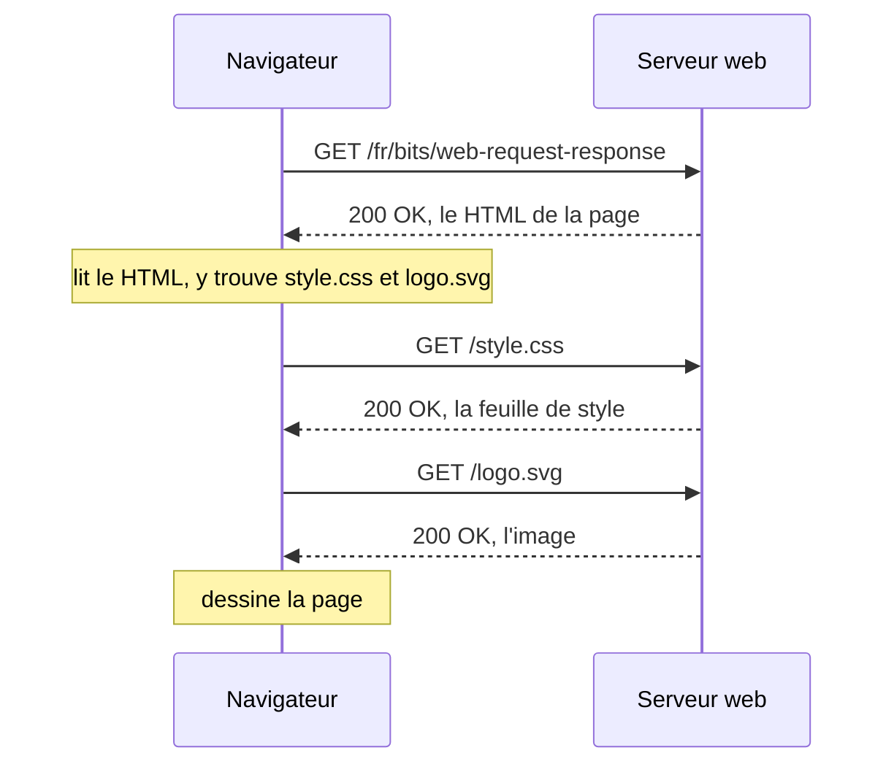

Quand vous tapez une adresse dans un navigateur, il demande une page à un serveur, et ce qu'il reçoit en retour, c'est du texte. Vous saurez lire une adresse web (une **URL**), ce que contiennent une requête et une réponse **HTTP**, ce que veulent dire les codes 200, 301 et 404, ce qu'ajoute HTTPS, et pourquoi une page ouverte depuis votre disque ne se comporte pas comme une page servie.

**Prérequis** : [Les architectures d'un programme](https://byte-layers.com/fr/bits/program-architectures), pour le client léger, le navigateur et le serveur web.

# Le web : une adresse, une requête, une page

Dans le contenu sur les architectures, l'appli Prêts de la bibliothèque devenait une application web : le navigateur du poste demandait, le serveur web répondait. Ce contenu regarde de près une de ces demandes, celle qui affiche une page.

## Une adresse web : l'URL

Tout commence par une adresse, l'**URL** (*Uniform Resource Locator*). Elle dit au navigateur trois choses : comment parler au serveur, à quel serveur, et quelle ressource lui demander. Prenons celle de ce contenu :

```text
https://byte-layers.com/fr/bits/web-request-response
```

| Morceau | Nom | Ce qu'il dit |
|---|---|---|
| `https` | le **protocole** | la langue que parlent le navigateur et le serveur : HTTP, ici dans sa version chiffrée |
| `byte-layers.com` | le **nom de domaine** | le serveur à joindre ; le navigateur le traduit en adresse de machine avant de se connecter |
| `/fr/bits/web-request-response` | le **chemin** | la ressource demandée sur ce serveur |

Une URL peut aussi finir par des **paramètres**, après un `?` : dans `https://www.google.com/search?q=html`, le paramètre `q` vaut `html`, le texte à chercher. Et un `#` à la fin, comme `#codes`, désigne un endroit dans la page : le navigateur le garde pour lui et ne l'envoie pas au serveur.

```fill
text: "Dans l'adresse `https://developer.mozilla.org/fr/docs/Web/HTML`, le protocole est _____, le nom de domaine est _____ et le chemin est _____."
blanks:
  - answers: [https]
    hint: Le protocole est écrit avant `://`.
  - answers: [developer.mozilla.org]
    hint: Le nom de domaine va de `://` jusqu'à la première barre oblique `/`.
  - answers: [/fr/docs/Web/HTML, fr/docs/Web/HTML]
    case: exact
    hint: Le chemin commence à la première barre oblique après le nom de domaine, et la casse compte.
```

## Une requête, une réponse : le protocole HTTP

Le navigateur et le serveur se parlent en **HTTP** (*HyperText Transfer Protocol*). Le principe est celui du client-serveur que vous connaissez : le navigateur, le **client**, envoie une **requête** ; le serveur renvoie une **réponse**. Les deux sont du texte. Voici la requête que votre navigateur envoie pour cette page, réduite à ses premières lignes :

```http
GET /fr/bits/web-request-response HTTP/1.1
Host: byte-layers.com
User-Agent: Mozilla/5.0 (Macintosh; Intel Mac OS X 10_15_7) …
Accept: text/html
```

La première ligne porte la **méthode**, `GET` (« donne-moi »), le chemin et la version du protocole. Les lignes suivantes sont des **en-têtes** (*headers*) : le serveur visé (`Host`), le navigateur qui demande (`User-Agent`), le format qu'il préfère (`Accept`). Le serveur répond, lui aussi en texte :

```http
HTTP/1.1 200 OK
Content-Type: text/html; charset=utf-8

<!DOCTYPE html>
<html lang="fr">
<head>
  <title>Le web : une adresse, une requête, une page</title>
  <link rel="stylesheet" href="/style.css">
…
```

La première ligne donne le **code de statut**, `200 OK` : la page existe, la voici. L'en-tête `Content-Type` dit ce que contient la réponse, ici du HTML. Après une ligne vide vient le **corps** de la réponse : la page elle-même, du texte écrit en HTML. Le navigateur ne reçoit pas une image de la page, il reçoit ce texte, et c'est lui qui le lit et dessine la page.

> 💡 **Remarque.** `GET` n'est pas la seule méthode. Quand vous envoyez un formulaire, le navigateur utilise souvent `POST`, qui transporte des données vers le serveur. Ce sera l'objet du contenu sur les formulaires.

## Une page, plusieurs requêtes

Une page se sert presque toujours d'autres fichiers : une feuille de style, des images, des scripts. Le navigateur ne les reçoit pas avec la page. Il lit le HTML, y trouve leurs adresses, comme `/style.css` dans la réponse ci-dessus, et envoie **une requête par fichier**.



Une page d'un site d'information en déclenche souvent plusieurs dizaines. Les outils de développement du navigateur les montrent toutes, dans l'onglet **Réseau** (*Network*) : c'est la première étape du lab de ce cours.

## Les codes de statut : 200, 301, 404, 500

Le code de statut est un nombre à trois chiffres, et son premier chiffre donne la famille de la réponse. Vous n'avez pas à les connaître tous : ces quatre-là suffisent pour lire ce qui se passe dans l'onglet Réseau.

| Code | Famille | Ce qu'il veut dire | Ce que vous voyez |
|---|---|---|---|
| `200 OK` | 2xx, succès | la ressource existe, la voici | la page s'affiche |
| `301 Moved Permanently` | 3xx, redirection | la ressource a déménagé, voici sa nouvelle adresse | l'adresse change toute seule dans la barre, puis la page s'affiche |
| `404 Not Found` | 4xx, erreur du client | rien à cette adresse | une page « introuvable », souvent dessinée par le site |
| `500 Internal Server Error` | 5xx, erreur du serveur | le serveur a planté en préparant la réponse | une page d'erreur ; ce n'est pas votre faute |

Une redirection 301 se voit facilement : tapez `http://wikipedia.org`, l'adresse devient `https://www.wikipedia.org/`. Le serveur a d'abord répondu 301 avec la nouvelle adresse, et le navigateur a refait la requête tout seul.

## HTTPS : la même conversation, chiffrée

Avec `http://`, la requête et la réponse voyagent en clair : toute machine sur le trajet, le Wi-Fi d'un café par exemple, peut les lire. Avec `https://`, le navigateur et le serveur établissent d'abord une connexion chiffrée, puis échangent exactement les mêmes requêtes et réponses à l'intérieur. Le serveur prouve aussi son identité par un **certificat**, que le navigateur vérifie : c'est ce qu'indique le cadenas à côté de l'adresse. Aujourd'hui, presque tous les sites passent par HTTPS, et la plupart redirigent `http://` vers `https://` par un 301, comme Wikipédia.

## Une page ouverte depuis le disque : `file://` n'est pas `http://`

Pendant ce cours, vous écrirez des pages sur votre machine et vous les ouvrirez par un double-clic. L'adresse commence alors par `file://`, par exemple `file:///Users/alice/byte-layers/web/basics/index.html`. Dans ce cas, **il n'y a pas de serveur** : le navigateur lit le fichier directement sur le disque.

| | Page servie (`http://`, `https://`) | Page ouverte depuis le disque (`file://`) |
|---|---|---|
| Qui fournit le fichier | un serveur web, en réponse à une requête HTTP | le système de fichiers de votre machine |
| Code de statut | oui : 200, 404… | aucun : le fichier existe ou non |
| Un chemin qui commence par `/` | part de la racine du site | part de la racine de votre disque |
| Majuscules dans les noms de fichiers | comptent sur la plupart des serveurs, qui tournent sous Linux | ignorées par défaut sous Windows et macOS |

Les deux dernières lignes expliquent la plupart des pages qui « marchent chez moi » et cassent une fois en ligne. Une extension comme **Live Preview** de VS Code fait tourner un petit serveur sur votre machine : l'adresse devient alors `http://127.0.0.1:3000/…`, et vous voyez de vrais codes de statut.

> 📖 [Comment fonctionne le Web (MDN)](https://developer.mozilla.org/fr/docs/Learn_web_development/Getting_started/Web_standards/How_the_web_works) · [Aperçu du protocole HTTP (MDN)](https://developer.mozilla.org/fr/docs/Web/HTTP/Guides/Overview) · [Codes de statut des réponses HTTP (MDN)](https://developer.mozilla.org/fr/docs/Web/HTTP/Reference/Status) · [Qu'est-ce qu'une URL ? (MDN)](https://developer.mozilla.org/fr/docs/Learn_web_development/Howto/Web_mechanics/What_is_a_URL)

## Trois questions pour vérifier ce que vous avez retenu

```quiz
title: "Une adresse, une requête, une page"
tracksProgress: false
showNotice: false
place: stage
questions:
  - prompt: "Vous tapez une adresse, et elle change toute seule dans la barre avant que la page ne s'affiche. Quel code le serveur a-t-il d'abord répondu ?"
    answers:
      - "200 : la page existe"
      - "301 : la ressource a déménagé, et le navigateur a suivi la nouvelle adresse"
      - "404 : rien à cette adresse"
    correct: 2
    explanation: "Un code 3xx est une redirection : la réponse donne une nouvelle adresse, et le navigateur refait la requête tout seul. C'est ce que fait `http://wikipedia.org`, redirigé vers `https://www.wikipedia.org/`."
  - prompt: "Une page utilise une feuille de style et deux images. Combien de requêtes HTTP le navigateur envoie-t-il au moins pour l'afficher ?"
    answers:
      - "Une seule : le serveur envoie la page avec tout ce qu'elle contient"
      - "Deux : une pour le HTML, une pour le reste"
      - "Quatre : une pour le HTML, puis une par fichier qu'il y trouve"
    correct: 3
    explanation: "Le navigateur reçoit d'abord le HTML, y trouve les adresses des autres fichiers, puis envoie une requête pour chacun : la feuille de style et les deux images."
  - prompt: "Vous ouvrez `index.html` par un double-clic, et l'adresse commence par `file://`. Que se passe-t-il ?"
    answers:
      - "Le navigateur lit le fichier sur le disque : pas de serveur, donc pas de code de statut"
      - "Le navigateur envoie une requête HTTP à votre machine, qui répond 200"
      - "La page ne peut pas s'afficher sans serveur"
    correct: 1
    explanation: "Avec `file://`, aucun serveur n'intervient : le navigateur lit le fichier directement. La page s'affiche, mais sans requête HTTP ni code de statut, et certaines règles changent, comme les chemins qui commencent par `/`."
```

## Récap

- Une **URL** donne le protocole (`https`), le nom de domaine (le serveur) et le chemin (la ressource), parfois des paramètres après `?`.
- Le navigateur envoie une **requête HTTP** (`GET` et un chemin, des en-têtes) ; le serveur renvoie une **réponse** : un code de statut, des en-têtes, puis le corps, du texte.
- Une page déclenche **une requête par fichier** : le HTML d'abord, puis la feuille de style, les images, les scripts qu'il cite.
- Les **codes de statut** : 200 succès, 301 redirection, 404 introuvable, 500 erreur du serveur.
- **HTTPS** chiffre la même conversation et vérifie l'identité du serveur par un certificat.
- Une page ouverte depuis le disque (`file://`) ne passe par aucun serveur : pas de statut, et des chemins et des majuscules qui ne se comportent pas comme en ligne.

Le navigateur reçoit du texte. Ce texte mélange en fait trois langages, chacun avec son rôle et son standard : c'est l'objet du contenu [Une page web : HTML, CSS et JavaScript](https://byte-layers.com/fr/bits/web-page-languages).

```ack
J'ai compris
```
